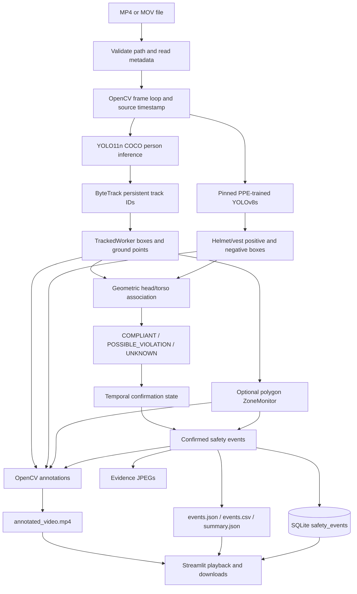

# SiteGuard SIWES Defense Code Guide

Prepared from the implementation in this repository and re-verified on **12 October 2026**. Accuracy is prioritized over presentation claims.

## A. Two-minute project explanation

SiteGuard is an offline construction-video analysis system. A user supplies an MP4 or MOV file. SiteGuard reads the video frame by frame, uses the pretrained Ultralytics `yolo11n.pt` model to detect people, and uses ByteTrack to give detected people persistent tracking IDs across consecutive frames. A separate PPE-trained YOLOv8s model looks for positive and negative helmet and safety-vest classes. SiteGuard geometrically associates those PPE boxes with the head or torso region of each tracked worker.

The PPE logic is deliberately conservative. A person is `COMPLIANT` only when both positive helmet and vest evidence are associated. A `POSSIBLE_VIOLATION` requires an explicit negative class such as `no-hardhat` or `no-safety vest`; a missed or occluded item becomes `UNKNOWN`, not a violation. A possible violation is recorded only after repeated observations across frames.

Users may also provide a named polygon representing a restricted area. SiteGuard tests the bottom-centre of each tracked person box against that polygon and records entry, exit, and time inside. The polygon is user-defined; the system does not automatically know which real-world areas are dangerous.

The software exports an annotated MP4, JSON and CSV event logs, a JSON summary, an SQLite database, and evidence JPEGs for confirmed events. A Streamlit interface provides upload, configuration, playback, metrics, and downloads. The project is a decision-support prototype, not a certified safety product.

My original engineering work is the end-to-end integration: model adapters, device fallback, PPE-to-worker matching, conservative status rules, temporal confirmation, polygon geometry, incident state machines, event deduplication, evidence capture, persistence, reporting, UI, and automated tests. I did not invent YOLO or ByteTrack and did not train the supplied pretrained weights.

## B. Full technical walkthrough

### 1. Problem addressed

Reviewing long construction videos manually is slow and inconsistent. SiteGuard converts prerecorded video into reviewable visual overlays and structured, timestamped safety evidence. It focuses on three questions:

1. Where are people, and can the same trajectory be followed across frames?
2. Is there explicit visual evidence about a tracked worker's helmet and safety vest?
3. Has the tracked worker's estimated ground point crossed a user-configured restricted polygon?

It does not identify people by name, infer hazards automatically, or make legally binding compliance decisions.

### 2. Actual implementation status

| Capability | Status | Evidence |
|---|---|---|
| MP4/MOV input and metadata | Implemented | `src/siteguard/video.py:12-41` |
| Real pretrained person detection | Implemented | `src/siteguard/detection.py:43-139` |
| ByteTrack persistent IDs | Implemented | `src/siteguard/detection.py:112-139`, `tracking.py:11-18` |
| PPE-specific inference | Implemented when weights are available | `src/siteguard/ppe.py:50-146` |
| Conservative PPE association/classification | Implemented | `src/siteguard/ppe.py:154-230` |
| Multi-frame PPE confirmation | Implemented | `src/siteguard/ppe.py:242-297` |
| Polygon zones and entry/exit duration | Implemented when a user supplies a polygon | `src/siteguard/zones.py:20-158` |
| Event deduplication | Implemented | `src/siteguard/events.py:10-24` |
| Annotated MP4 and evidence JPEGs | Implemented | `src/siteguard/pipeline.py:240-279` |
| SQLite/JSON/CSV/summary exports | Implemented | `database.py`, `reporting.py` |
| Streamlit prerecorded-video dashboard | Implemented | `app.py:37-131` |
| Webcam, RTSP, live alarm service | Not implemented | CLI and dashboard accept files only |
| Automatic real-world hazard inference | Not implemented by design | Zones come from the user |
| Model training/retraining in this app | Not implemented | Only inference adapters exist |
| Real construction-site accuracy study | Not completed | No labelled real footage or ground truth |

### 3. Architecture and processing workflow



### 4. AI and computer-vision explanation

#### YOLO theory

YOLO means “You Only Look Once.” An object detector receives an image and predicts bounding boxes, class probabilities, and confidence values in one model pass. Unlike image classification, which assigns a label to an entire image, object detection also localizes each object with coordinates `(x1, y1, x2, y2)`.

#### YOLO in this code

The person adapter defaults to `yolo11n.pt` (`src/siteguard/detection.py:48`). This is the nano YOLO11 checkpoint pretrained on COCO. SiteGuard requests only COCO class `0`, person, and defaults to confidence `0.35` (`detection.py:73-82`). The model itself is third-party; SiteGuard's adapter parses its tensors into project `Detection` and `TrackedWorker` dataclasses.

The PPE path is a different model because COCO person detection cannot establish helmet/vest compliance. Constants at `src/siteguard/ppe.py:14-26` identify:

- repository: `constructelligence/construction-site-safety-hazards`;
- file: `buildvision-hazards-v0.3.pt`;
- pinned revision: `45d07d8e27a4754df1ea651f62153e000133bece`;
- relevant positive labels: helmet/hardhat and vest/safety vest;
- relevant negative labels: no helmet/no hardhat and no vest/no safety vest.

Other model classes are ignored by the SiteGuard PPE adapter. The weights and Ultralytics dependency are AGPL-3.0 according to the documented model provenance; see `docs/ppe-model.md`.

#### Confidence score

A confidence score is the model's strength of support for a particular predicted box/class, not a probability that the whole safety decision is correct. Both person and PPE thresholds default to 0.35 in `PipelineConfig` (`pipeline.py:41-42`) and can be changed with CLI options or dashboard sliders. Raising a threshold usually removes weak detections but may increase missed objects; lowering it may retain more false positives.

#### ByteTrack theory and implementation

Object detection treats frames independently; object tracking tries to connect detections into trajectories. ByteTrack uses box motion/overlap and both higher- and lower-confidence detections to maintain numerical track IDs. It does not know a person's identity.

SiteGuard calls Ultralytics `model.track` with `persist=True` and `tracker="bytetrack.yaml"` (`detection.py:112-118`). `persist=True` tells the tracker that the next call is the next frame of the same stream. The returned `box.id` becomes `TrackedWorker.track_id`. IDs may still change after long occlusion, crowd overlap, or missed detection, so the summary names them “tracking IDs,” not verified unique workers.

#### Apple Silicon device handling

`select_device` chooses MPS when `torch.backends.mps.is_available()` is true, otherwise CPU (`detection.py:11-22`). Both model adapters retry on CPU if MPS inference raises an exception (`detection.py:73-91`, `ppe.py:77-92`). The synthetic evaluation sandbox used CPU because MPS was built but unavailable there.

### 5. PPE association and classification

PPE detection and person tracking are independent outputs. `associate_ppe` must decide which helmet/vest box belongs to which tracked worker (`ppe.py:185-230`).

1. `_matches_region` calculates the PPE-box centre (`ppe.py:149-166`).
2. Horizontal position must lie within the worker box plus an 8% margin.
3. Helmet evidence must lie from 12% above the person's top to 48% down the box.
4. Vest evidence must lie between 18% and 88% down the box.
5. `_gear_status` chooses the highest-confidence positive and negative candidates (`ppe.py:169-182`). A negative wins only if present and at least as confident as the best positive.

Overall states (`ppe.py:201-206`):

- `POSSIBLE_VIOLATION`: either helmet or vest has explicit negative evidence;
- `COMPLIANT`: both helmet and vest have positive evidence;
- `UNKNOWN`: every other case, including no detection, partial evidence, occlusion, or weights unavailable.

Important defense sentence: **absence of a detected helmet is not treated as proof of no helmet.** The code requires an explicit negative model class before proposing a violation.

`TemporalPPEMonitor` stores a sliding deque per track (`ppe.py:242-297`). Defaults require 3 possible-violation observations within 5 observations, with the newest observation also a violation. An active incident is emitted once. Two consecutive compliant observations clear it and clear the old history before a later incident can be confirmed.

### 6. Polygon hazard zones

A `HazardZone` is a name plus at least three `(x, y)` pixel points (`zones.py:41-50`). `TrackedWorker.ground_point` is the bottom-centre of the person box (`models.py:29-38`), an approximation of where the feet touch the image plane.

`point_in_polygon` implements boundary-inclusive ray casting (`zones.py:20-38`). The algorithm sends an imaginary horizontal ray from the point and toggles inside/outside when polygon edges cross it. `_on_segment` first treats points exactly on the boundary as inside.

`ZoneMonitor.update` maintains an incident dictionary keyed by `(track_id, zone_name)` (`zones.py:74-137`):

- first inside frame → one `ENTRY`;
- remaining inside frames → update last-seen state, no duplicate entry;
- observed outside after inside → one `EXIT` with duration;
- missing track → wait 15 frames by default, then close with reason `track_lost`;
- open incident at video end → close with reason `stream_end`.

No valid polygons were supplied for the three Sora evaluation clips, so those runs intentionally had an empty zone list.

### 7. Prerecorded versus real-time

SiteGuard currently supports prerecorded MP4 and MOV files. `validate_video_path` accepts only those suffixes (`video.py:12-23`), the CLI positional input is a `Path` (`cli.py:38`), and Streamlit accepts an uploaded file (`app.py:43`). Processing is a blocking offline frame loop.

It is not a genuine webcam/RTSP monitor: there is no camera index, RTSP URL, continuous service loop, alert delivery system, reconnection logic, or latency guarantee. ByteTrack itself can be used in real-time systems, but this application has not implemented that deployment mode.

### 8. Exact video pipeline trace

1. CLI arguments are parsed by `src/siteguard/cli.py:33-78`, or Streamlit builds a `PipelineConfig` at `app.py:83-95`.
2. `AnalysisPipeline.run` validates the path and imports OpenCV (`pipeline.py:127-142`).
3. OpenCV opens `VideoCapture`; `read_metadata` reads FPS, frame count, width, and height (`video.py:26-41`).
4. `open_mp4_writer` tries H.264 `avc1` and then `mp4v` (`video.py:59-75`).
5. Person detector, ByteTrack wrapper, PPE adapter, zone monitor, temporal monitor, deduplicator, and SQLite store are initialized (`pipeline.py:158-180`).
6. Each successful `capture.read()` produces one frame (`pipeline.py:191-194`).
7. Timestamp comes from `CAP_PROP_POS_MSEC`; if unavailable, `frame_number / fps` is used (`video.py:44-56`).
8. `tracker.update(frame)` returns tracked people; `ppe_detector.detect(frame)` returns relevant PPE boxes; `associate_ppe` creates per-worker observations (`pipeline.py:200-203`).
9. Zone transitions and PPE temporal transitions are converted into `SafetyEvent` objects only when their rules allow (`pipeline.py:206-238`).
10. `_draw_annotations` draws optional zone lines, colored worker boxes/IDs/statuses, ground points, and PPE boxes/confidences (`pipeline.py:48-111`).
11. Every new event receives an evidence JPEG path and is inserted into SQLite (`pipeline.py:248-254`).
12. Every annotated frame is written to the output MP4 (`pipeline.py:255`).
13. At end-of-stream, open zone incidents are finalized, reports are generated, and `AnalysisResult` is returned (`pipeline.py:268-302`).
14. The `finally` block releases capture, writer, and database even if a failure occurs (`pipeline.py:303-308`).
15. Streamlit stores the result in session state, plays the annotated file, renders event rows, and offers five downloads (`app.py:96-131`).

### 9. Database and exported files

`SQLiteEventStore` creates one table named `safety_events` (`database.py:19-39`):

| Column | Meaning |
|---|---|
| `event_id` | UUID primary key; also prevents duplicate insertion of the same event object |
| `event_type` | `PPE_POSSIBLE_VIOLATION`, `HAZARD_ZONE_ENTRY`, or `HAZARD_ZONE_EXIT` |
| `worker_tracking_id` | ByteTrack trajectory number |
| `video_filename` | Source basename |
| `source_timestamp` | Seconds into the source video |
| `frame_number` | Zero-based source frame index |
| `confidence` | Supporting model confidence, nullable |
| `supporting_evidence_json` | Structured evidence such as zone duration or PPE detections |
| `description` | Human-readable review text |
| `evidence_frame_path` | Relative JPEG path when written |
| `created_at` | UTC record-creation timestamp |

`insert` uses parameterized `INSERT OR IGNORE` (`database.py:41-64`). `list_events` reconstructs domain objects and can filter by video (`database.py:66-89`). SQLite WAL mode and an index on `video_filename` are enabled.

`write_reports` (`reporting.py:58-100`) creates:

- `events.json`: full event objects;
- `events.csv`: flat event rows, with evidence encoded as JSON text;
- `summary.json`: metadata, frame count, observed track IDs, event counts, PPE availability, and limitations.

`annotated_video.mp4`, `siteguard.db`, and `evidence/*.jpg` are created by the pipeline. Evidence is event-driven; a run with zero confirmed events correctly has zero evidence JPEGs.

## C. File-by-file code explanation

| Path | Main contents and interaction |
|---|---|
| `app.py` | Streamlit entry point. Parses polygon JSON, saves upload under an ignored run directory, builds `PipelineConfig`, calls `analyze_video`, shows metrics/video/events, and exposes downloads. |
| `src/siteguard/__main__.py` | Makes `python -m siteguard` call `cli.main`. |
| `src/siteguard/cli.py` | CLI entry point. Parses input/output, repeatable zone strings, model paths, thresholds, temporal settings, and device; prints progress and the returned summary. |
| `src/siteguard/models.py` | Dependency-light dataclasses and `PPEStatus`. `TrackedWorker.ground_point` feeds zones; `SafetyEvent` feeds persistence/reports; `AnalysisResult` connects pipeline to UI/CLI. |
| `src/siteguard/errors.py` | Expected domain exceptions for input, decoding, writer, and model loading. |
| `src/siteguard/detection.py` | Loads YOLO11n, chooses device, normalizes tensor values, runs person prediction/tracking, and converts boxes into domain objects. |
| `src/siteguard/tracking.py` | Small ByteTrack façade whose `update` delegates consecutive frames to `PersonDetector.track`. |
| `src/siteguard/ppe.py` | Pinned PPE weight retrieval, inference, label filtering, spatial matching, state aggregation, and temporal confirmation. |
| `src/siteguard/zones.py` | Pure polygon geometry plus per-track/per-zone incident state, duration, track-loss tolerance, and finalization. |
| `src/siteguard/events.py` | Active-incident deduplication and conversion from zone/PPE transitions to `SafetyEvent` records. |
| `src/siteguard/video.py` | Suffix/path checks, metadata extraction, timestamp fallback, and MP4 codec selection. |
| `src/siteguard/database.py` | SQLite schema, inserts, queries, resource cleanup, and context-manager support. |
| `src/siteguard/reporting.py` | Accuracy-neutral summary and JSON/CSV writers. |
| `src/siteguard/pipeline.py` | Orchestrates the complete frame loop and all dependencies. Supports injection of tracker/PPE/OpenCV fakes for tests. |
| `pyproject.toml` | Python 3.11+ packaging, runtime dependencies, optional app/test dependencies, console entry point, and pytest configuration. |
| `requirements.txt` | One-command runtime/test dependency list, including `lap` required by ByteTrack. |
| `tests/` | Deterministic geometry, state, persistence, report, error, timestamp, and mocked-model tests. |
| `docs/` | Architecture, methodology, model provenance, testing, evaluation, limitations, demo, presentation, and verified synthetic-results documentation. |

## D. Actual architecture diagram

Use the Mermaid diagram in section B.3. A compact verbal version is:

> “OpenCV decodes a frame. YOLO11n and ByteTrack produce tracked people. A separate PPE YOLO model produces PPE boxes, which my code associates to each tracked worker and confirms across time. My polygon state machine independently checks the worker ground point. Confirmed transitions become event objects, evidence images, SQLite rows, JSON/CSV reports, while OpenCV writes every annotated frame to MP4. Streamlit calls the same pipeline and displays its results.”

## E. Testing and limitations

### Newly verified automated tests

Command run on 12 October 2026:

```bash
PYTHONPATH=src /tmp/siteguard-eval-env/bin/python -m pytest -q
```

Result: **18 passed in 0.05 seconds**.

| Test file | What it verifies |
|---|---|
| `tests/test_zones.py` | Boundary-inclusive containment, one entry/exit per incident, duration, short dropped-detection tolerance, lost-track exit |
| `tests/test_ppe.py` | Positive aggregation, absence→`UNKNOWN`, explicit negative→possible violation, missing-weight adapter, temporal confirmation/clearing/deduplication |
| `tests/test_events.py` | Active incident keys suppress repeats and allow a later incident after deactivation |
| `tests/test_video.py` | Source timestamp and FPS fallback, missing/unsupported input errors |
| `tests/test_database.py` | SQLite round trip, JSON evidence restoration, primary-key idempotency |
| `tests/test_reporting.py` | Observed counts, JSON/CSV exports, explicit unavailable-PPE limitation, no fabricated accuracy field |
| `tests/test_detection_mocked.py` | Fake YOLO boxes test person-class filtering, confidence filtering, coordinate parsing, and track IDs; not model accuracy |
| `tests/test_pipeline_errors.py` | Missing file fails before model loading; zero decoded frames raises `VideoDecodeError` and does not write successful reports |

There is no repository test that trains a model or proves neural-network accuracy. Mocked tests prove integration logic only.

### Synthetic-video evidence newly verified

Three Sora-generated videos were processed with real person/ByteTrack/PPE inference. All source frames were processed and all output MP4s reopened with matching metadata. Results are in `docs/synthetic-evaluation/RESULTS.md`.

- Video 1: 97 frames, 9 observed IDs, 8.49 s cached run.
- Video 2: 97 frames, 8 observed IDs, 7.68 s cached run.
- Video 3: 361 frames, 19 observed IDs, 22.43 s cached run.
- All: PPE model available, zero confirmed PPE events, no configured zone, zero events/evidence JPEGs.

This proves pipeline execution on synthetic media, not accuracy. No real construction footage has been evaluated, PPE quality has not been scored, false positives/negatives are unknown, and no formal multi-run throughput benchmark exists.

### Important limitations

- Detection can fail under occlusion, blur, distance, unusual pose, or domain shift.
- Track IDs can fragment or switch and are not identities.
- PPE association is geometric, not pose-based, and can attach gear to the wrong person when boxes overlap.
- `UNKNOWN` is common and intentional when visual evidence is incomplete.
- Negative PPE classes can still be wrong; every event needs human review.
- Zones are 2D image polygons with no camera calibration or depth understanding.
- The bottom-centre person-box point approximates feet/ground contact.
- Temporal windows count observations/frames, so their wall-clock duration depends on FPS.
- Annotation labels overlap in crowded scenes.
- Output codec availability depends on the OpenCV build.
- File processing is offline, not a real-time monitoring service.
- Synthetic footage cannot validate real-world construction performance.

## F. Thirty likely defense questions and answers

### 1. Why did you choose this project?

Construction safety is a meaningful computer-vision problem with clear engineering outputs: detections, trajectories, rule transitions, evidence, and reports. It allowed me to demonstrate ML integration, algorithms, video processing, databases, testing, and UI design in one system.

### 2. What exactly does SiteGuard do?

It processes prerecorded MP4/MOV video, tracks detected people, associates helmet/vest evidence, optionally monitors user-defined polygons, annotates the video, and exports events to SQLite/JSON/CSV with evidence frames.

### 3. Why did you choose YOLO?

YOLO performs object localization and classification in one inference pass and has efficient small checkpoints suitable for a laptop. Ultralytics also provides a practical Python API and ByteTrack integration.

### 4. Which exact YOLO models are used?

People use `yolo11n.pt`, a COCO-pretrained YOLO11 nano model. PPE uses pinned `buildvision-hazards-v0.3.pt`, a PPE-trained YOLOv8s checkpoint from the documented Hugging Face repository.

### 5. Did you train the models yourself?

No. I integrated pretrained weights and clearly document their provenance. My contribution is the application architecture and safety logic around those models, not claiming authorship of their training.

### 6. What is the difference between detection and tracking?

Detection finds and labels boxes in one frame. Tracking links boxes across consecutive frames and assigns trajectory IDs, allowing temporal rules and zone duration.

### 7. Why ByteTrack?

It is a lightweight multi-object tracker that can maintain trajectories using motion/overlap and detections at different confidence levels. It integrates directly with Ultralytics and avoids adding a heavier identity-recognition model.

### 8. Are tracking IDs unique people?

No. They are temporary trajectory numbers. One person can receive another ID after a long occlusion, and crowded overlap can cause an ID switch.

### 9. How does the system know a worker is missing a helmet?

It does not infer violation merely because a helmet is not detected. It requires the PPE model to explicitly output a negative class such as `no-hardhat`, associate that box with the worker's head region, and repeat that possible-violation observation across frames.

### 10. What is a confidence score?

It is the model's strength of support for one predicted box/class. It is not proof of safety or a guaranteed probability that the full decision is correct.

### 11. How are confidence thresholds configured?

Both default to 0.35 in `PipelineConfig`. The CLI exposes `--person-confidence` and `--ppe-confidence`; Streamlit exposes sliders from 0.10 to 0.90.

### 12. What do the three PPE states mean?

`COMPLIANT` means both positive helmet and vest evidence were associated. `POSSIBLE_VIOLATION` means at least one explicit negative class won. `UNKNOWN` means evidence was absent, incomplete, unavailable, or ambiguous.

### 13. What happens when PPE is occluded?

It usually becomes `UNKNOWN`, not violation. This avoids treating a missed detection as proof that PPE is missing.

### 14. How are PPE items assigned to a worker?

My code takes each PPE box centre and tests whether it falls in an expanded horizontal worker box and an expected head or torso vertical region. This is fast but can fail when people overlap.

### 15. How does the system prevent false alarms?

It requires explicit negative classes, uses spatial association, requires three negative observations within a five-observation window, and suppresses repeated events while the same incident is active. These reduce noise but cannot eliminate model error.

### 16. What happens if two workers overlap?

Person boxes, track IDs, and PPE regions can overlap. ByteTrack can switch IDs and the geometric association can attach PPE to the wrong worker. Pose/keypoint matching is a future improvement.

### 17. How do you define a restricted area?

The user supplies a named polygon as source-image pixel coordinates. CLI syntax is `--zone 'Name:x,y;x,y;x,y'`; Streamlit accepts a JSON list of points.

### 18. How does point-in-polygon work?

The code uses ray casting. It counts/toggles edge crossings from the test point and includes boundary points using a separate line-segment check.

### 19. Why use the bottom-centre of the person box?

It approximates the person's foot/ground position better than the box centre for floor-zone entry. It is still only an image-space approximation.

### 20. How are zone incidents recorded without duplicates?

`ZoneMonitor` keeps an inside-state entry for each `(track_id, zone_name)`, so remaining inside does not re-enter. `EventDeduplicator` adds a second active-key guard at event creation.

### 21. How is time inside a zone calculated?

The entry source timestamp is stored, and exit duration is `exit_timestamp - entered_at`. Timestamps come from the source video when available, otherwise frame index divided by FPS.

### 22. What if a tracked person disappears while inside?

The monitor waits 15 missing frames by default. If the track does not return, it closes the incident at the last seen timestamp with reason `track_lost`, rather than pretending an exit was directly observed.

### 23. How are incidents stored?

Each `SafetyEvent` has a UUID, type, track ID, filename, timestamp, frame, confidence, structured evidence, description, optional image path, and UTC creation time. It is written to SQLite and later exported to JSON/CSV.

### 24. Why SQLite?

It is serverless, transactional, portable, and easy to inspect during a laptop demonstration. It is appropriate for a single-machine academic prototype.

### 25. Is SiteGuard real-time?

No. This implementation processes uploaded or command-line video files offline. The models/tracker could be building blocks for real-time work, but camera/RTSP ingestion, latency control, continuous operation, and live alerts are not implemented.

### 26. What did the synthetic-video test prove?

It proved that three supplied Sora clips could be decoded, passed through real models and ByteTrack, annotated, encoded, and reported without frame loss. It did not prove model accuracy or real-world site performance.

### 27. Why were there no PPE event reports?

The model ran and visible frames included `COMPLIANT` and `UNKNOWN` statuses, but the temporal rule did not confirm repeated explicit negative evidence. Zero events is a valid outcome and should not be changed to make the demo look dramatic.

### 28. Why were there no zone events?

No valid restricted polygon was provided for those clips, so I correctly ran with an empty zone list. Zero therefore means “not configured,” not “no worker entered danger.”

### 29. Which part did you personally implement?

The modular pipeline, model adapters, MPS/CPU fallback, data models, PPE association rules, conservative states, temporal monitor, polygon algorithm, incident states, deduplication, evidence handling, SQLite schema, reports, CLI, dashboard, and tests. The pretrained weights, YOLO framework, ByteTrack algorithm, OpenCV, Streamlit, and SQLite engine are third-party.

### 30. How would you improve SiteGuard?

I would label real authorized footage, calculate per-class precision/recall, measure ID switches, use pose/keypoints for PPE association, calibrate cameras for world-coordinate zones, improve annotation layout, add a human-review workflow, and only then evaluate a real-time deployment.

## G. Five code sections to demonstrate

### 1. Person detection plus ByteTrack

- Path: `src/siteguard/detection.py:73-91` and `112-139`
- Does: prepares model options, enforces person class and threshold, chooses MPS/CPU, calls persistent ByteTrack, and converts results to `TrackedWorker`.
- Say aloud: “This is where each frame becomes tracked person boxes. `persist=True` preserves tracker state, while `box.id` becomes my worker trajectory ID.”
- Likely follow-up: “Is the ID a person's identity?”
- Answer: “No. It is only a temporary trajectory number and can change after occlusion.”

### 2. PPE-to-worker association and status

- Path: `src/siteguard/ppe.py:154-230`
- Does: matches PPE centres to head/torso regions, selects positive/negative evidence, and derives all three status values.
- Say aloud: “I do not classify PPE with the COCO person model. I use separate PPE boxes and match them geometrically to each tracked worker. Missing evidence becomes `UNKNOWN`.”
- Likely follow-up: “What happens when workers overlap?”
- Answer: “Geometric matching can be ambiguous; pose-guided association would improve it.”

### 3. Temporal violation confirmation

- Path: `src/siteguard/ppe.py:242-297`
- Does: keeps a bounded history per track, requires 3 negative observations in a 5-observation window, suppresses a continuous incident, and clears after 2 compliant observations.
- Say aloud: “One uncertain frame cannot create an incident. This state machine requires repeated explicit negative evidence and emits only once until the track recovers.”
- Likely follow-up: “Why not require three consecutive frames?”
- Answer: “The sliding window tolerates an occasional missed/unknown observation while still requiring the latest observation to be negative. The thresholds are configurable.”

### 4. Polygon entry/exit state machine

- Path: `src/siteguard/zones.py:20-38` and `84-158`
- Does: ray-casting containment, entry creation, duration tracking, duplicate prevention, dropped-track tolerance, and end-of-stream closure.
- Say aloud: “I test the bottom-centre ground point against the user polygon, then maintain one active incident per track and zone so every inside frame does not create a new alert.”
- Likely follow-up: “Does SiteGuard discover dangerous areas?”
- Answer: “No. The polygon must be configured by a user who understands the scene.”

### 5. End-to-end frame loop and exports

- Path: `src/siteguard/pipeline.py:127-308`, especially `191-302`
- Does: opens the video, processes every frame, calls tracking/PPE/zones, records confirmed events/evidence, writes annotated MP4, finalizes reports, and releases resources.
- Say aloud: “This is the orchestrator. The ML models produce observations, my state machines decide whether they become events, and the same confirmed event is persisted consistently across evidence, SQLite, JSON, and CSV.”
- Likely follow-up: “How do you avoid leaking files if an error occurs?”
- Answer: “Capture, writer, and database are released in the `finally` block.”

## H. Exact demo commands

### Clean setup

The existing local `.venv` is Python 3.9 and its OpenCV binary is broken on the inspected machine. Do not use it for the defense. Create a separate environment:

```bash
cd /Users/user/Desktop/site-monitor
python3 -m venv .venv-siteguard
source .venv-siteguard/bin/activate
python -m pip install -r requirements.txt
PYTHONPATH=src python -m pytest -q
```

### Reproduce the verified synthetic run

```bash
PYTHONPATH=src python -m siteguard videos/video3.mp4 \
  --output outputs/synthetic/video3 \
  --download-ppe-model
```

Do not add `--zone` unless you have inspected this exact video and defined/justified a valid polygon. The first run may download model weights; run it once before the defense if venue internet is uncertain.

### Start the dashboard

```bash
streamlit run app.py
```

Upload `videos/video3.mp4`. Disable the zone checkbox unless you have a real polygon for the clip. Leave public PPE weights enabled and start analysis.

### Locate outputs

```bash
ls -lh outputs/synthetic/video3/
open outputs/synthetic/video3/annotated_video.mp4
python -m json.tool outputs/synthetic/video3/summary.json
python -m json.tool outputs/synthetic/video3/events.json
sqlite3 outputs/synthetic/video3/siteguard.db \
  'SELECT event_type, worker_tracking_id, source_timestamp, description FROM safety_events;'
```

Expected output directory:

```text
outputs/synthetic/video3/
├── annotated_video.mp4
├── events.csv
├── events.json
├── evidence/          # empty in this verified run
├── siteguard.db
└── summary.json
```

## I. One-page revision cheat sheet

### Core facts

- Input: prerecorded MP4/MOV only.
- Person model: `yolo11n.pt`, COCO class 0, threshold 0.35.
- Tracking: ByteTrack via `model.track(... persist=True, tracker="bytetrack.yaml")`.
- PPE: separate pinned YOLOv8s checkpoint, threshold 0.35.
- PPE association: box-centre within approximate head/torso region of tracked person.
- `COMPLIANT`: positive helmet **and** positive vest.
- `POSSIBLE_VIOLATION`: explicit negative helmet or vest evidence.
- `UNKNOWN`: missing, partial, occluded, ambiguous, or unavailable evidence.
- Confirmation: 3 possible violations in last 5 observations; latest must be violation.
- Recovery: 2 consecutive compliant observations.
- Zone: user polygon, bottom-centre ground point, boundary-inclusive ray casting.
- Events: zone entry/exit or confirmed possible PPE violation.
- Outputs: annotated MP4, evidence JPEGs, SQLite, JSON, CSV, summary.
- UI: Streamlit calls the same pipeline as CLI.
- Not real-time; not identity recognition; not a certified safety system.

### Best demo facts

- Best clip: `video3.mp4` (synthetic, not company footage).
- 1024×576, 24 FPS, 361 frames, 15.04 s.
- Cached CPU processing: 22.43 s, ~16.09 processed frames/s.
- Observed tracking IDs: 19, not necessarily 19 unique humans.
- Confirmed PPE events: 0.
- Zone events: 0 because no zone was configured.
- Best screenshot: frame 120 / 5.0 s.
- Tests newly verified: 18/18 passed.

### Honest phrases to use

- “The model suggests; a human reviews.”
- “Tracking ID is a trajectory, not an identity.”
- “Unknown is safer than assuming violation from absence.”
- “The zone is user-configured, not automatically inferred.”
- “The synthetic run verifies integration, not real-world accuracy.”

### Claims to avoid

- Do not say you trained YOLO or ByteTrack.
- Do not call synthetic clips A & K footage.
- Do not claim accuracy, precision, recall, mAP, or zero false alarms.
- Do not call tracking IDs a worker headcount.
- Do not claim zone safety when no polygon was configured.
- Do not call SiteGuard real-time.

## J. Anything that remains unverified

1. Accuracy on real, authorized construction footage.
2. Person-detection false positives and false negatives.
3. Helmet/vest per-class precision, recall, and mAP for this deployment domain.
4. PPE-to-worker association accuracy in crowded scenes.
5. Track continuity and number of ID switches.
6. Hazard-zone behavior on the three synthetic clips, because no polygon was supplied.
7. World-coordinate correctness; there is no camera calibration.
8. Real-time webcam/RTSP latency and stability; that mode is not implemented.
9. Long-video memory/storage behavior and sustained throughput.
10. Performance distribution across repeated runs and different Apple Silicon devices.
11. Browser compatibility when OpenCV falls back from H.264 to `mp4v`.
12. Legal/privacy suitability for workplace deployment.
13. Performance under night conditions, rain, dust, extreme occlusion, and other domain shifts.
14. Whether the existing third-party model licences meet any future commercial deployment plan.

## Final defense reminder

Understand the difference between model output and application logic. YOLO supplies boxes/classes/confidence; ByteTrack supplies trajectory IDs. Your code decides how PPE evidence belongs to a track, when uncertainty remains unknown, when repeated evidence becomes an incident, how a polygon transition is maintained, and how events become auditable files. That distinction is the strongest and most accurate description of your engineering contribution.
