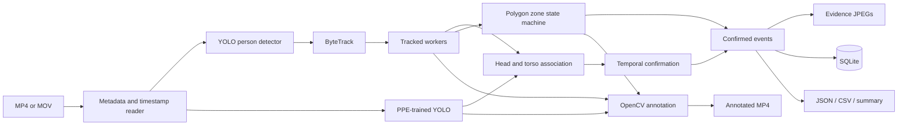

# System architecture

SiteGuard is an offline, frame-by-frame analysis pipeline. Each run owns fresh model/tracker state so ByteTrack IDs cannot leak between unrelated videos.

## Modules

| Module | Responsibility |
|---|---|
| `detection.py` | Loads the COCO person model, selects MPS/CPU, parses detections, and retries on CPU if an MPS inference fails. |
| `tracking.py` | Runs consecutive frames through Ultralytics ByteTrack with persistent state. |
| `ppe.py` | Loads optional PPE-specific weights, normalizes labels, associates head/torso evidence, and confirms repeated negative labels. |
| `zones.py` | Provides boundary-inclusive polygon containment and stateful entry/exit incidents. |
| `events.py` | Creates explicit event records and suppresses repeated events from a continuous incident. |
| `database.py` | Persists events in SQLite using stable event IDs. |
| `reporting.py` | Writes deterministic JSON/CSV and a limitations-first summary. |
| `video.py` | Validates input, extracts metadata, preserves timestamps, and initializes MP4 codecs. |
| `pipeline.py` | Coordinates decoding, inference, annotation, evidence, persistence, reports, and cleanup. |
| `app.py` | Provides the Streamlit upload, configuration, results, and downloads workflow. |

## Data and control boundaries

Person and PPE inference are separate because a COCO person model does not classify construction PPE. A tracked worker is the shared unit: zone logic consumes the worker's bottom-centre point, while PPE logic consumes the worker box as a spatial association region.

The event boundary is deliberately conservative. An empty PPE detection set creates `UNKNOWN`; only an explicit model class such as `no-hardhat`, repeated over the configured temporal window, can create `PPE_POSSIBLE_VIOLATION`.

## Failure behavior

- Missing/unsupported/unopenable videos fail with user-facing domain errors before inference.
- A zero-frame decode fails explicitly and does not create reports that look successful.
- A premature decoder stop after some frames is retained as a limitation in `summary.json`.
- Brief worker detection drops do not immediately close a zone incident.
- Longer lost tracks close the incident with `exit_reason: track_lost`; video-end closures use `stream_end`.
- If PPE weights cannot be loaded or downloaded, processing continues with `UNKNOWN` PPE states.
- Writers and SQLite connections are released in a `finally` block.
